# Digital crew intercom for an armoured vehicle: engineering dossier

Rev B, 10 Nov 2026 (Rev A 9 Nov: see the revision history at the end). Portfolio and thesis-preparation work; not a product, not certified.

This dossier follows the systems-engineering spine of Wasson, *System Engineering Analysis, Design, and
Development*, 2nd ed. (Wiley, 2016) [W]. Each section names the chapter and pages it applies. Every
engineering number carries a reference key [Rn] (list in §17) and a status:
- **V**: read in the source.
- **G**: read off a published graph, ±2 dB.
- **D**: derived from V/G values by a stated method.
- **A**: an assumption of this study.

The models, firmware and tests that produce the results are in the same repository. §14 lists what is
assumed and what is sourced.

---

## 0. The question and the short answer

**Open engineering question.** Can crew speech stay intelligible in vehicle noise of 110 dB(A) or more,
within a fixed latency and sidetone budget and within the hearing-exposure limit? And how does the
intercom stay fail-operational when a crew box, the bus or the central unit fails?

**Short answer, from the models in this repository:**

1. **Intelligibility is lost on the transmit side, not at the ear.**
   - In the 111 dB(A) tracked-vehicle spectrum [R2], a pressure-gradient boom microphone at 1.5 cm with a
     "raised" voice (the MIL-STD-1474E prediction assumption [R4]) gives a transmit SNR of −4 to −8 dB in
     the 2–8 kHz bands.
   - That caps the STI at the listener at **0.44**, whatever the earphone level, the ANR or the codec.
   - The threshold STI 0.41 (MRT 85 %, MIL-STD-1474E 4.3.1 and Table I [R4]) is reachable.
   - The objective 0.48 (MRT 90 %) needs **at least 3 dB more transmit SNR**. That comes from the
     microphone and its noise shield, or the talker's effort, not from DSP (S1, §9.2).
2. **The hearing dose is the binding constraint at 110 dB(A) and above.**
   - Under the crew helmet alone [R17] the ear sees 94.8 dB(A).
   - Broadband ANR [R3] brings this to 85.9 dB(A), and the speed-referenced tonal ANR of this design takes
     a further 0.6 dB off.
   - Even then, the 8-h TWA at the operating point is 89.9 dB(A), against the 85 dB(A) limit of
     MIL-STD-1474E 4.2.3.1 c [R4]. That allows 2.6 h at the ear.
   - The configurations studied stay within dose and intelligibility up to **108–109 dB(A)** (tracked) and
     **105 dB(A)** (wheeled).
   - Above that, about **10 dB more passive attenuation** is needed (a communication earplug under the
     helmet, A). The digital design cannot supply it.
   - With the earplug and a 3 dB better microphone (C6), the limit moves to 114 dB(A) tracked and 113 dB(A)
     wheeled, at STI 0.55.
3. **Latency decides where each kind of ANR may run** (S2, §9.3).
   - Broadband feedback ANR is bounded by how predictable the noise is over the loop delay:
     - 34 dB at 50 µs;
     - 12 dB at 0.5 ms;
     - about 1 dB at 2 ms.
   - So it must stay analog or sample-by-sample on a low-latency converter path.
   - Tonal ANR referenced to the track-laying frequency tolerates the whole 1 ms frame pipeline. On
     speed-jittered tones it keeps 57 dB at 0.2 ms, 46 dB at 2 ms and 35 dB at 8 ms of loop delay.
   - It is only as good as its reference, though:
     - a **sprocket-phase pick-up** gives about 35 dB on jittering track tones;
     - the bus speed value at 50 Hz gives 29 dB;
     - a 1 % speed-scale error drops it to 18 dB at best;
     - 0.5 Hz of tone wander that no sensor sees drops it to 10 dB at best.
4. **Fail-operational is achievable and cheap with an analog emergency path**, but only as good as fault
   detection (S6, §10).
   - A digital star without a bypass loses commander–driver voice in 693 of 10^6 12-h missions.
   - With a fail-safe relay to an analog party line, that falls to 37 per 10^6.
   - At 50 % BIT coverage of internal crew-box faults it rises to 183 per 10^6.
   - The crew-box firmware drops to the bypass 20 ms after the last bus frame, or within about 2 ms (1 tick + the
     relay hold time) if the processor stalls. Both are measured in Renode (§13.3).
   - The emergency path itself is self-tested at standstill (Rev B). It used to be a latent failure.
5. **Architecture.** In the weighted analysis of alternatives, the digital star with CCU mixing and an
   analog bypass (A2) scores 7.47 and TSN with distributed mixing (A3) scores 7.38. A2 wins 68 % of
   20 000 random weightings, and no ±10 % single-weight change flips the result (S5, §8).

---

## 1. Problem space (W ch. 4, pp. 76–98)

**Problem statement** (one sentence, no solution words; W p. 92). Crew members cannot reliably understand
each other or the radio nets while the vehicle moves at high noise levels, or after a single equipment
failure.

**Discussion.**
- Interior noise of tracked and wheeled armoured vehicles at speed is 110–125 dB(A).
  - A tracked APC measured 113–117 dB(A) at 40 km/h [R1] (V).
  - A tracked and a wheeled armoured vehicle measured 111 and 110 dB(A) at 60 km/h [R2] (V).
  - A NATO survey of 26 land vehicles gives 80 dB(A) to above 110 dB(A) [R3] (V).
- MIL-STD-1474E puts any area at 100 dB(A) or more into category A: no direct person-to-person
  communication is expected. Below that, category B needs "electrically aided communication via an
  attenuating helmet or headset" [R4 Table A-I] (V).
- The intercom is therefore the only voice path between crew members. Its loss in a tactical phase is a
  mission and safety hazard.

**Need typing** (W Principle 4.12, p. 89).
- **Real need:** intelligible crew coordination at full noise.
- **Projected need:** more radio nets and data on the same harness.
- **Perceived need:** "louder headsets". Loudness is not the need (§9.2), and it costs noise dose.

**Stakeholders** (after W Table 4.2, pp. 84–85).

| Role | Description | Intercom concern |
|---|---|---|
| Commander (user) | directs crew, works 1–3 radio nets | override priority, monitoring several nets |
| Driver, gunner, loader (users) | execute orders | intelligibility at full noise, hands-free |
| Higher command (end user) | on the radio net | radio path latency, rebroadcast |
| Maintainer | field LRU swap | BIT localises the fault to a crew box, cable or headset |
| Vehicle integrator | power, harness, EMC | 28 V transients, harness mass, emissions |
| Acquirer / test authority | buys, qualifies | MIL-STD-461/810/1275 evidence, MRT/STI test |
| Threat | EW, acoustic signature | emission control, no radiated audio |

**Problem and solution space** (W Principles 4.17–4.18, Fig. 4.7, pp. 93–95).
- Problem space 1.0 "crew speech communication" splits into these solution spaces, each then a problem
  space of its own:
  - 1.1 headset (mic, earphone, passive and ANR);
  - 1.2 crew box;
  - 1.3 central communication unit (CCU);
  - 1.4 intercom bus and harness;
  - 1.5 radio interfaces;
  - 1.6 power.
- The question of §0 is a **critical technical issue** (CTI, W p. 100): STI, latency and noise dose must
  be met by the same design.

## 2. Mission analysis, use cases and scenarios (W ch. 5, pp. 99–128)

**Mission statement** (one outcome, W Principle 5.2): the crew keeps intelligible voice coordination,
internally and with external nets, for the whole vehicle mission.

**Mission objectives.**
- **Performance:** STI at the listener of at least 0.41 (threshold) and 0.48 (objective) in the
  operating noise.
- **Mission reliability:** commander–driver voice for a 12-h operating period (A) with a probability of at
  least 0.9999.
- **Constraint:** noise exposure at the ear within MIL-STD-1474E.

**Phases** (W Principle 5.7, p. 110):
- **Pre-mission:** power-up, BIT, load the net plan, fit the headset.
- **Mission:** road march, tactical move, engagement, recovery.
- **Post-mission:** log download, headset care.

**Mission event timeline** (W Fig. 5.5, p. 112):

```
 t0 vehicle power on -> t1 intercom ready (BIT pass, all boxes NORMAL) -> t2 nets keyed
 -> t3 movement (noise 100-115 dB(A)) -> t4 contact / engagement (noise peaks, gun) -> t5 damage event
    (box, cable or CCU lost: emergency path within 20 ms + relay time) -> t6 recovery -> t7 power off
```

**MOE/MOP tree** (W Fig. 5.8, p. 116).
- **MOE:** intelligible crew coordination.
- **MOPs:**
  - STI at the listener;
  - mouth-to-ear latency;
  - sidetone delay;
  - ANR attenuation;
  - failover time to the emergency path;
  - noise dose at the ear.
- **MOSs:**
  - crew-box MTBF;
  - LRU swap time;
  - BIT coverage;
  - operation with gloves.

**Use cases** (verb–outcome titles; priority = frequency × criticality, W Principle 5.18, p. 121).

| ID | Use case | Primary actor | Frequency | Criticality |
|---|---|---|---|---|
| UC1 | Talk to the crew | any crew member | continuous | high |
| UC2 | Talk on a radio net | commander | frequent | high |
| UC3 | Monitor several nets with priority | commander | frequent | medium |
| UC4 | Hear a vehicle warning over all audio | vehicle | rare | high |
| UC5 | Keep talking after a crew-box, bus or CCU failure | any crew member | rare | **high** |
| UC6 | Rebroadcast between two radio nets | commander | occasional | medium |
| UC7 | Maintain and calibrate the ANR at standstill | maintainer | rare | low |

**UC5 actor–system exchange** (after W Table 5.1, p. 123):

| Step | User (actor) | System (actor) |
|---|---|---|
| 1 | talks normally | carries speech through the crew box, bus, CCU, bus and crew box (NORMAL) |
| 2 | – | the CCU dies, so downlink frames stop |
| 3 | – | each crew box conceals 3 frames, then mutes; after 20 ms without a frame it de-energises its relay (BYPASS) |
| 4 | keeps talking | the headset is now on the analog emergency party line; every box in BYPASS hears every other |
| 5 | – | the box keeps sending telemetry-only frames; when the link is good for 2 s, it returns to NORMAL |

**Scenarios and compensating provisions** (W Principle 5.23, pp. 122–125):

| Scenario | Compensating provision |
|---|---|
| CCU dead | analog bypass in every box |
| bus cut at one box | that box goes to BYPASS; procedure: the commander orders "all on emergency" |
| processor hang | dynamic relay drive drops the relay |
| wrong ANR calibration | divergence guard switches the ANR off |
| 28 V surge or crank | input stage design (§11.3) |
| headset fault | BIT, plus a spare headset |

## 3. Concept of operations (W ch. 6, pp. 129–146)

**Operations** (W Table 6.4, p. 143). Normal, degraded and emergency operations are specified
separately, not as footnotes:
- **Normal ops:** digital path. Each crew box has local sidetone and ANR. The CCU mixes intercom and radio
  channels and sends four channels to each box; each box applies priority and volume locally.
- **Degraded ops:** one function lost (the ANR off after its guard trips). The digital path continues.
- **Emergency ops:** the CCU or a link is lost, or a crew box has a critical fault. That box's headset is
  switched by a fail-safe relay onto an independent analog emergency line.

**Maintenance concept.**
- The crew box, CCU and headset are LRUs, swapped at field level (MTTR 0.5 h, A).
- BIT localises a fault to the LRU and reports through the uplink telemetry.

**Context diagram** (Level 0):

```
            28 V vehicle power (MIL-STD-1275E)      vehicle data bus (speed, sprocket phase)
                         |                                     |
 radios 1..n <--audio/PTT--> [ CCU ] <==bus==> [ crew box 1 ] <--> headset 1 (mic, earphones, ANR mic)
                              |    <==bus==> [ crew box 2 ] <--> headset 2
                              |    <==bus==> [ crew box n ] <--> headset n
                              +---- analog emergency party line (all crew boxes, independent of CCU) ----
 environment: 110-125 dB(A) noise, shock/vibration, EMI from own transmitters, -46..+71 C
```

## 4. Phases, modes and states (W ch. 7, pp. 147–173)

**Vocabulary** (W p. 148; Principles 7.1–7.7):
- **Phases** are the mission phases of §2.
- **Modes** are selected by the user or the system:
  - CCU system modes: NORMAL, REBROADCAST, MAINTENANCE.
  - Crew-box operating states: INIT, NORMAL, DEGRADED, BYPASS, MAINT.
- **Configuration states:** relay energised or de-energised, ANR on or off, net routing.
- **Environmental states:** noise band (<85, 85–100, 100–110, ≥110 dB(A)).
- **Entry into DEGRADED and BYPASS is automatic**, triggered by a health change. Wasson lists "Degraded
  Operations" both as a mode (Table 7.3, p. 162) and as an operational state (p. 156). This dossier
  treats it as an automatic transition with its own allowable actions.

**Crew-box transition table** (W Table 7.1 format, p. 158, with the time constraint of Fig. 7.6; exit
criteria of the current state, W Author's Note 7.4, p. 159). It is implemented in
`fw/lib/icom/src/modes.c` and tested in `fw/tests/unit/test_modes.c` and in Renode IT01–IT10.

| Current | Event | Trigger (criteria) | Next | Time limit | Req. |
|---|---|---|---|---|---|
| INIT | E1 | first valid downlink frame, no critical BIT fault | NORMAL (DEGRADED if ANR fault) | next 1 ms tick | CB-20 |
| INIT | E2 | no link within 2 s of POST | BYPASS (not latched) | 2 s | CB-21 |
| any | E3 | critical BIT fault (codec, supply) | BYPASS, **latched** | next tick | CB-24 |
| NORMAL, DEGRADED, MAINT | E4 | no valid frame for 20 consecutive ticks | BYPASS | 20 ms + 1 tick | CB-22 |
| BYPASS (not latched) | E5 | 2000 consecutive good frames | NORMAL / DEGRADED | 2 s | CB-23 |
| NORMAL | E6 | ANR guard trip | DEGRADED | 0.2 s after the trip criterion | CB-25 |
| DEGRADED | E7 | ANR fault cleared (reset) | NORMAL | next tick | CB-25 |
| NORMAL, DEGRADED | E8 | MAINT_ENTER command **and speed = 0** | MAINT | next tick | CB-28 |
| MAINT | E9 | MAINT_EXIT, speed > 0, or 10 min | NORMAL / DEGRADED | next tick | CB-28 |
| any digital | E10 | processor stall (no relay-drive toggle) | relay drops (hardware) | 1 tick + relay hold | CB-27 |

The 2 s recovery hysteresis (E5) is deliberate. A link that keeps dropping must not toggle the crew
between the digital path and the emergency line. Renode IT03 holds the link at 50 % frame loss for 3 s
and sees zero transitions.

**Allowable/prohibited actions** (W Fig. 7.14, p. 171). P cells flow down as design constraints (W p. 172).

| Mode \ action | talk crew | talk radio | change routing | rotate S_hat / calibrate ANR | firmware update |
|---|---|---|---|---|---|
| NORMAL | A | A | A | **P** (refused, `box.c` `command()`) | P |
| DEGRADED | A | A | A | P | P |
| BYPASS | A (analog line) | P (no radio on the emergency line, A) | P | P | P |
| MAINT (standstill only) | A | A | A | A | A |

**CCU system modes.**
- REBROADCAST connects radio 1 receive to radio 2 transmit and the reverse, with the commander
  monitoring. It is a CCU routing state; the crew box needs no change because it receives channels with
  activity flags.
- The CCU core is built: `fw/lib/icom/src/ccu.c`, requirements CCU-01 … CCU-08.
  - In REBROADCAST, a radio that no crew member keys retransmits the other radio's receive audio while that
    radio's squelch is open. A crew member keying the radio overrides it.
  - The commander's box has priority on every radio.
  - These behaviours are tested in `test_ccu.c` and, with four crew boxes on real frames, in `test_system.c`.

## 5. Requirements (W ch. 19–22, pp. 397–464)

**Approach.**
- Performance-based at system level; the block diagram stays an internal model, not a mandated design
  (W Principle 20.5, p. 424).
- One measure of performance per requirement (W Principle 20.1, p. 418).
- Each statement has subject, "shall", verb, outcome, level and condition (W Principle 22.5, p. 449).
- Threshold and objective are tagged inline (W p. 410).
- The wording rules ban "all", "etc." and "and/or" (W Principle 22.21, p. 461).

**System requirements derived from standards** (outline after W Table 20.1, pp. 417–418; operations
categories after W Fig. 19.5 and Principle 19.22, pp. 408–411):

| ID | Requirement (abridged) | Source (trace) | Verif. |
|---|---|---|---|
| SYS-3.2.1 | In the noise of §3.5 at 110 dB(A), the intercom shall deliver crew speech at an STI ≥ 0.41 (T) / ≥ 0.48 (O), measured per IEC 60268-16 ed. 5. | MIL-STD-1474E 4.3, 4.3.1 and Table I (MRT 85 % → STI 0.41) [R4]; MIL-STD-1472G Table XX (91 % MRT normal acceptable) [R5] | A (S1), T |
| SYS-3.2.2 | The intercom shall keep the 8-h TWA at the ear below 85 dB(A), including the intercom output. | MIL-STD-1474E 4.2.3.1 c [R4] | A (S1), T |
| SYS-3.2.3 | The earphone output shall not exceed 115 dB peak at the ear. | MIL-STD-1472G 5.3.1.8.2 a(3) [R5] | T |
| SYS-3.2.4 | Sidetone delay shall be ≤ 10 ms (design-to; the human limit is 20 ms). | Stone & Moore 1999/2002, "disturbing" at 20–30 ms [R20][R21] | A (S4), T |
| SYS-3.2.5 | Crew-to-crew mouth-to-ear delay shall be ≤ 20 ms. | proxy: own-voice limit [R20][R21] (A); G.114 150 ms is the end-to-end bound [R24] | A, T |
| SYS-3.2.6 | The binaural delay between the two earphones shall be ≤ 1 ms. | MIL-STD-1472G 5.3.1.6 i [R5] | I |
| SYS-3.2.7 | After any single failure of a crew box, a bus link or the CCU, commander–driver speech shall resume within 50 ms. | W Fig. 19.5 abnormal and emergency ops; UC5 | T (Renode IT02/IT08), A |
| SYS-3.2.8 | Mission reliability of commander–driver speech over 12 h shall be ≥ 0.9999. | mission objective §2 (A) | A (S6) |
| SYS-3.3.1 | Vehicle warnings shall be heard over every other channel. | UC4 | T |
| SYS-3.3.2 | Sidetone shall be provided in phase, unfiltered. | MIL-STD-1472G 5.3.1.6 j [R5] | I, T |
| SYS-3.3.3 | The microphone path shall improve peak-speech-to-noise by ≥ 10 dB over a non-noise-cancelling microphone in ≥ 100 dB low-frequency noise. | MIL-STD-1472G 5.3.1.6 d(2) [R5] | T |
| SYS-3.4.1 | The intercom shall operate from 20 to 33 V and ride through 1275E surges, spikes, IES and cranking without reset. | MIL-STD-1275E 5.1.1–5.1.3, Table I [R27] | A (S7), T |
| SYS-3.5.1 | The equipment shall meet MIL-STD-461G CE102, CS101, CS114, CS115, CS116, RE102 and RS103 (Army ground). | MIL-STD-461G Table V [R29] | T |
| SYS-3.5.2 | The equipment shall meet the MIL-STD-810H methods of §11.2. | MIL-STD-810H [R30]–[R32] | T |

**Flow-down** (W ch. 21, pp. 429–445).
- The UC1 thread (capture → crew box → bus → CCU → bus → crew box → earphone) apportions the latency
  budget (§7.2). STI is a synthesis budget, flowed down through the validated model (W Principle 31.5).
- The crew-box software requirements are in [`fw/SRS.md`](fw/SRS.md): CB-01 … CB-47 with lineage to the
  SYS IDs. `fw/tools/trace.py` checks every CB requirement against a unit test or a Renode test, and
  fails CI otherwise.

**Allocation matrix** (W Fig. 21.9, p. 440). X marks where a requirement is allocated.

| Capability | Headset | Crew box HW | Crew-box SW | Bus | CCU | Procedures |
|---|---|---|---|---|---|---|
| STI (SYS-3.2.1) | X (mic, passive) | X (codec) | X (gain, limiter) | | X (mix) | X (voice effort) |
| Noise dose (SYS-3.2.2) | X (passive, ANR) | | X (limiter, tonal ANR) | | | X (mission time) |
| Latency (SYS-3.2.4/5) | | X (converters) | X (frame) | X | X | |
| Fail-operational (SYS-3.2.7) | | X (relay, emergency amp) | X (supervision, relay drive) | X | X | X (drill) |

## 6. Architecture and interfaces (W ch. 26–27, pp. 542–598)

**Level 1 architecture (selected A2, §8).**
- **Crew box** (one per station; RT1064-class MCU, audio codec, RS-485 transceiver, relay, emergency
  amplifier, controls).
- **CCU** (radio interfaces, mixing, routing, system modes).
- **Star bus:** point-to-point RS-485, 1 ms TDM frames.
- **Analog emergency party line,** independent of the CCU.
- **Headsets** with a passive helmet, broadband ANR, an error microphone and a pressure-gradient boom
  microphone.

**Redundancy types** (W pp. 565–568):
- The emergency path is **cold-standby, unlike redundancy**: analog against digital, so the two do not
  share common-mode software or clock faults.
- It is engaged by a fail-safe relay: de-energised means bypass.
- The relay coil is powered through a charge pump driven by a toggling GPIO, so a stalled processor drops
  the relay without software help. A static GPIO level would not.
- A single connector into both paths would still be a single failure point (W Fig. 26.11, p. 567), so the
  emergency line uses its own connector pins (A).

**Control** (W Fig. 26.9, pp. 562–564).
- Mixing is centralised in the CCU. Priority, volume, sidetone, ANR and failure detection are distributed
  to each crew box, so a CCU loss only removes mixing and radios.
- The TSN alternative (A3) would also distribute mixing (§8).

**Interface register** (W Principle 27.6, keyed source–destination):

| ID | From → to | Type | Content |
|---|---|---|---|
| HS-CB | headset → crew box | analog | boom mic (balanced), error mic, PTT |
| CB-HS | crew box → headset | analog | earphone drive (speech + sidetone + anti-noise) |
| CB-BUS / BUS-CB | crew box ↔ CCU | RS-485, 1 ms TDM frames | uplink: state, BIT, telemetry, mic audio; downlink: 4 audio channels, flags, speed, command |
| CB-EL | crew box ↔ emergency line | analog, transformer-isolated | party line |
| VPWR | vehicle → crew box, CCU | 28 V DC | MIL-STD-1275E envelope |
| VDB | vehicle → CCU | data | speed and sprocket phase (for the tonal ANR) |

**Bus frame ICD** (after the packet template of W Figs. 27.4/27.5, p. 590; implemented in
`fw/lib/icom/src/frame.c`).

`0xA5 0x5A | len | type | payload[len] | CRC-16/CCITT-FALSE (over len, type, payload)`

- **Downlink** (type 0x01):
  - seq, CCU mode, channel-active flags;
  - speed (0.01 km/h);
  - cmd, arg;
  - nch;
  - nch × 16 samples × int16 at 16 kHz.
- **Uplink** (type 0x81):
  - seq, box ID, state, BIT bits, PTT;
  - telemetry ID, telemetry value (rotating: state/cause, ANR attenuation, frames lost, CRC errors);
  - nch;
  - 0 or 16 samples.
- **Size and load:**
  - a full downlink is 143 bytes per ms, which is 1.43 Mbit/s with 8N1;
  - at 10 Mbit/s RS-485 that is **14 % of the link**, inside the 50 % utilisation goal (W p. 590);
  - the uplink is 47 bytes per ms (4.7 %).

## 7. Performance budgets and margins (W ch. 31, pp. 666–681)

Method: W Fig. 31.1 and Example 31.3 (pp. 669–671). Each budget has an allocated value, a design-to value
and a margin. The reserve is held at the top level, with no stacked 10 % per leaf (p. 671). Worst-case
(late-finish) values are used (p. 674).

### 7.1 STI and noise-dose budget (synthesis, through the S1 model)

Tracked vehicle, 111.3 dB(A) and 124.9 dB lin at the crew position [R2]; raised voice [R4]; mic at
1.5 cm (A).

| Item | Value | Basis |
|---|---|---|
| Ear noise, helmet only | 94.8 dB(A) | [R2] − helmet attenuation [R17] |
| Ear noise, + broadband ANR | 85.9 dB(A) | − ANR insertion gain [R3] (G) |
| Ear noise, + tonal ANR 20 dB on tonal share | 85.3 dB(A) | tonal share from the 1/3-octave spectrum (D): 94 % / 58 % / 50 % in 63/125/250 Hz |
| Transmit SNR at the mic, 125 Hz … 8 kHz | −0.4, 2.3, 9.8, 5.3, −3.9, −5.9, −7.6 dB | ANSI S3.5 raised speech [R14] + 36.5 dB near field (A) vs cab noise − mic rejection [R18] |
| Best STI, C3 (wideband, both ANRs) | **0.44** | IEC 60268-16 indirect [R11][R13], validated by STIPA (§9.4) |
| Speech level at the ear for STI 0.41 | 91 dB(A) | S1 |
| 8-h TWA at that point (speech duty 30 %, A) | 89.9 dB(A) | limit 85: **−4.9 dB margin (fails)**; allowed 2.6 h |
| Transmit SNR needed for the objective 0.48 | +3 dB | C5: STI 0.52, TWA 87.0 |
| Passive attenuation needed for 8 h at 111 dB(A) | +10 dB (earplug, A) | C6: ear noise 75.3 dB(A), STI 0.55, TWA 77.0 dB(A); limit of use 114.3 dB(A) |

### 7.2 Latency budgets (apportionment along the UC1 thread)

16 kHz sampling, 1 ms frames, converter filter A: ADC 17/fs, DAC 21/fs [R37] (V).

| Path | Elements (ms) | Total | Limit (design-to) | Margin |
|---|---|---|---|---|
| Sidetone, local in the crew box | ADC 1.06, input frame 1, processing 1, output frame 1, DAC 1.31 | **5.4 ms** | 10 ms | 4.6 ms (46 %) |
| Crew-to-crew, A2 star TDM | ADC 1.06, frame 1, box 1, slot wait 1, uplink 0.05, CCU mix 1, downlink 0.14, concealment buffer 1, output 1, DAC 1.31 | **8.6 ms** | 20 ms | 11.4 ms (57 %) |
| Crew-to-crew, A3 TSN | ADC 1.06, frame 1, box + packet 1, network 2 (class A bound [R36]), mix 1, output 1, DAC 1.31 | **8.4 ms** | 20 ms | 11.6 ms (58 %) |
| Radio path through the box | as A2 | 8.6 ms | 10 ms of the 150 ms G.114 budget [R24] (A) | 1.4 ms |

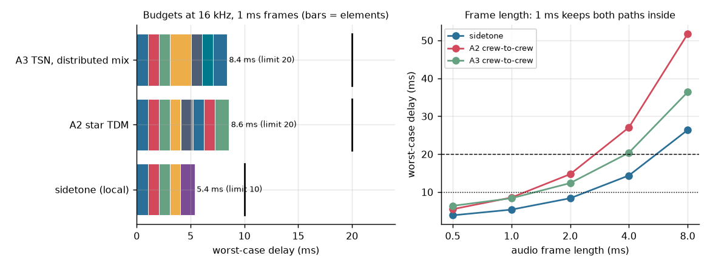

**Frame-length sensitivity (S4).** Sidetone takes 3.9 / 5.4 / 8.4 / 14.4 ms at 0.5 / 1 / 2 / 4 ms frames.
A 2 ms frame would leave only 1.6 ms of sidetone margin and 4 ms breaks it. **The 1 ms frame is a derived
requirement (CB-02).**

**MIL-STD-1472G 5.3.1.6 j** asks for sidetone "in phase". A digital path cannot be truly in phase. The
5.4 ms digital sidetone meets the human-factors limit, but the clean solution is the codec's analog
microphone-to-headphone bypass. This is recorded as decision D4 (§15).

### 7.3 Processing budget

One `icom_box_tick` per 1 ms frame: 16 samples × 3 harmonics of FxLMS, mixer, link and modes. The worst
case measured in Renode is in §13.3, against the 1 ms frame (a design-to limit of 0.5 ms keeps 50 % for
the codec DMA, the bus and later functions; A). Renode executes instructions at a configured rate, not
real Cortex-M7 timing, so this is a sanity check. A WCET needs the real board.

## 8. Analysis of alternatives (W ch. 32, pp. 682–702)

Trade-study report in the outline of W Table 32.1 (p. 691), condensed.

**Scope.** Choose the intercom transport and mixing architecture.

**Trade space** (W Fig. 32.4).
- A1 analog party line.
- A2 digital star: RS-485 point-to-point TDM, CCU mixing, local priority, sidetone, ANR and analog bypass.
- A3 audio over switched Ethernet with TSN/AVB class A streams, distributed mixing in each box, and the
  same bypass.
- A daisy-chain TDM bus was dropped before scoring: one cut isolates everything downstream.

**Method.**
- Weights are 1–10 importance ratings, auto-normalised (Wasson's recommended method, p. 694, instead of a
  100-point split, which he warns leads to "pushing points around").
- Measured criteria use linear utility (1–10) between the worst-acceptable and best values (Fig. 32.9).
- Judged criteria use 1–10 scores with a written reason.
- Sensitivity: ±10 % on each weight (p. 696) and 20 000 Dirichlet random weightings.

| Criterion (weight) | Measure | A1 | A2 | A3 |
|---|---|---|---|---|
| Fail-operational (10) | loss of commander–driver voice per 10^6 12-h missions (S6) | 578 | 37 | 37 |
| Intelligibility (9) | best STI, tracked vehicle; A1 sums 4 open mics, +6 dB noise (A) | 0.27 | 0.44 | 0.44 |
| Latency (7) | crew-to-crew worst case (S4) | 0 ms | 8.6 ms | 8.4 ms |
| EMC robustness (7) | judged | 4: audio-band lines, BCI audible | 8: differential, CRC, concealment | 7: isolated PHYs; faster edges raise the RE102 risk |
| Harness mass (5) | conductor-metres, 6 stations (A) | 240 | 144 | 144 |
| Growth (4) | judged | 3 | 6 | 9 |
| Cost and complexity (5) | judged | 8 | 6 | 4: TSN switch, gPTP, stream reservation |
| **Weighted total** | | 4.81 | **7.47** | 7.38 |
| Random weightings won | | 0.1 % | **67.7 %** | 32.2 % |

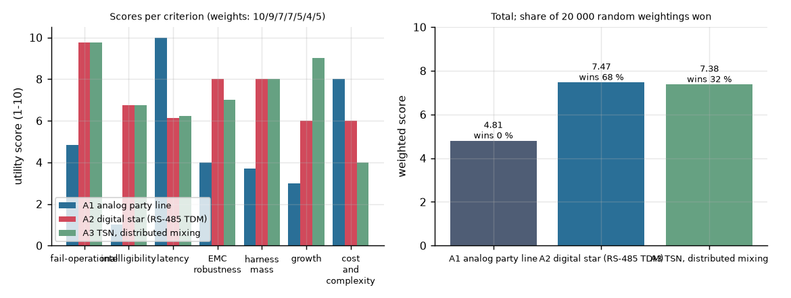

**Recommendation: A2.**
- No ±10 % single-weight change flips the result.
- A3 is the growth path once data and video share the network. Its advantage (no central mixer) matters
  less here because the bypass already removes the CCU as a single point of failure for voice.

**Other viewpoints and risks** (W p. 691).
- If the user needs about 10 or more crew and dismount stations, star cabling grows linearly and A3's
  switch ports win.
- The judged scores are this author's; a real study needs user ratings (W p. 692, NGT ballot).

## 9. Modelling and simulation (W ch. 33, pp. 703–720)

### 9.1 M&S plan

| Model | Question (CTI) | Type, fidelity | Inputs (source) | Validation | Where |
|---|---|---|---|---|---|
| Speech chain + STI (S1) | STI and dose vs noise, ANR, mic, codec | deterministic, octave-band, 2nd order | spectra [R2], helmet [R17], ANR [R3], speech [R14], mic [R18], IEC constants [R11] | against the direct STIPA method (S3) | `model/icsim/chain.py`, `sti.py` |
| ANR (S2, S3) | convergence, stability, latency | stochastic, time-domain, sample-exact | tones from track pitch [R1], speed jitter (A), path delay | stability boundary against theory (90°), C firmware against Python | `model/icsim/anr.py` |
| Latency budget (S4) | design-to vs limits | deterministic worst case | converters [R37], AVB bound [R36] | Renode measures the processing term | `model/icsim/budget.py` |
| AoA (S5) | architecture choice | decision model | S1, S4, S6 | sensitivity | `model/studies/s5_aoa.py` |
| RMA (S6) | mission reliability, MTBCF | parts count + RBD | MIL-HDBK-217F N2 GM [R34] | none possible without field data (A) | `model/icsim/rma.py` |
| 28 V input (S7) | surge stress | time-domain, first order | MIL-STD-1275E envelopes [R27] | needs a bench surge test | `model/studies/s7_power.py` |
| Crew-box firmware | modes, timing, bypass, ANR on target | the real C code on an emulated RT1064 | test image with plant model | host tests and Renode tests | `fw/` |

Accreditation stance (W p. 707): validated internally, not certified. Every result file in `results/` is
regenerated by `model/run_all.py` from the committed code.

### 9.2 Results: where intelligibility is lost (S1)

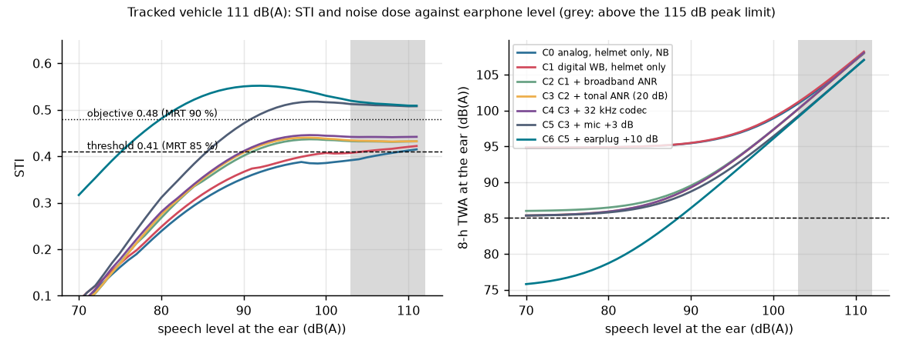

- Raising the earphone level helps until about 98 dB(A), then the STI flattens. The residual is
  **transmitted** noise, which rises with the speech.
- ANR lowers the level at which STI 0.41 is reached, from 100 to 91 dB(A), and that is where its dose
  benefit comes from.

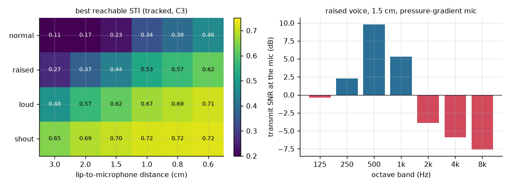

- The best reachable STI depends almost only on the microphone: lip distance and vocal effort.
- At 1.5 cm, a raised voice gives 0.44 and a loud voice 0.62.
- That is the lever for the objective, together with the MIL-STD-1472G ≥ 10 dB noise-cancelling
  requirement (SYS-3.3.3). The vendor's pressure-gradient curve gives 10 dB of rejection only below about 800 Hz.

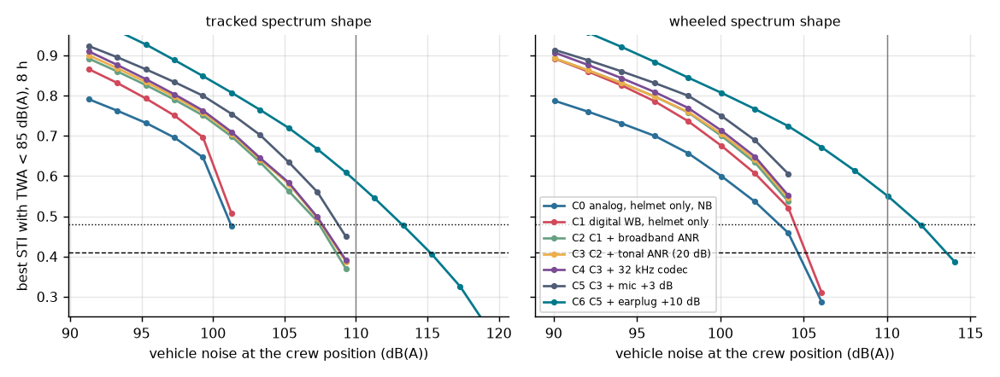

- With the dose constraint applied, every configuration loses the threshold before 110 dB(A) unless
  passive attenuation rises (C6).
- The wheeled vehicle is harder than its similar dB(A) suggests: its energy sits at 250 Hz–1 kHz, where
  the helmet is weakest (16–23 dB) and broadband ANR does little or amplifies (−4 dB at 1 kHz [R3]).

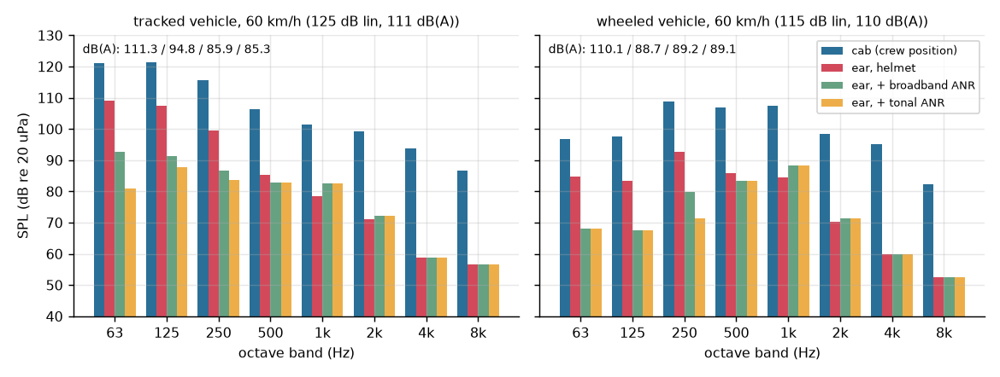

### 9.3 Results: adaptive ANR (S2)

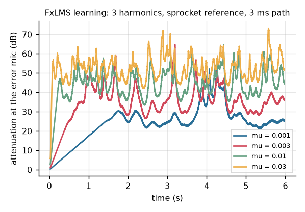 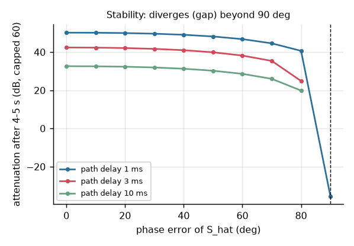

**Convergence.**
- Normalised step size μ = 0.01 at 4 kHz reaches 90 % of its final attenuation (45 dB) in 0.73 s.
- μ = 0.03 gives 54 dB but converges more slowly in this run (2.5 s), because the higher gradient noise
  delays the last few dB.

**Stability.**
- Attenuation holds up to about 80° of S_hat phase error.
- Beyond 90° the filter diverges (the gaps in the plot), as the filtered-x theory predicts.
- The firmware therefore carries a divergence guard: error power 6 dB above its pre-ANR value for 0.2 s,
  or a weight-magnitude bound. A trip switches the ANR off and the box to DEGRADED.

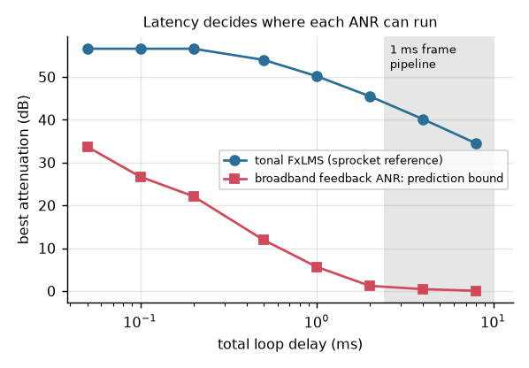 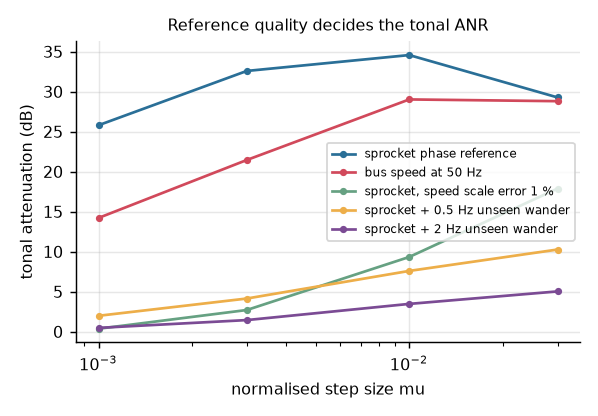

**Latency.**
- The broadband bound (Wiener prediction of the broadband part of the ear noise over the loop delay)
  falls from 34 dB at 50 µs to 12 dB at 0.5 ms and 1 dB at 2 ms.
- The TI converter delays at 192 kHz with filter C sum to 0.125 ms [R37], fast enough for broadband ANR.
- At 16 kHz they sum to 2.4 ms, which leaves broadband ANR nothing.

**Reference quality** (S2-D). The tonal ANR is limited by how well its reference follows the tones, not
by delay:

| Reference case | Tonal attenuation |
|---|---|
| sprocket phase | 33–35 dB |
| bus speed at 50 Hz | 29 dB |
| 1 % scale error | 9–18 dB, depending on μ |
| 0.5 Hz of unseen wander | 8–10 dB |

The line width of real track tones has not been measured anywhere this study could find. **It is the
first open question for the company (§16).**

### 9.4 Validation of the STI model (S3)

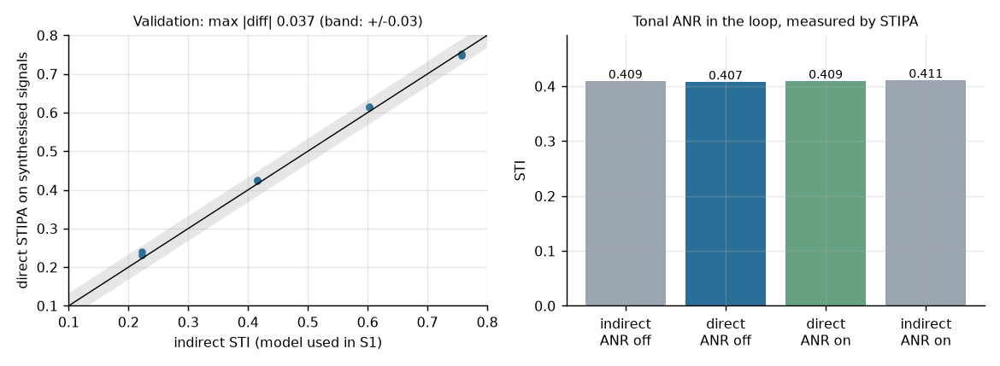

The indirect method used in S1 was checked against the direct STIPA method on synthesised signals: the
modulated test signal at the S1 operating-point band levels, plus noise at five SNR shifts and two seeds.
- At and above the operating point (STI ≥ 0.4), the direct values sit within **0.012** of the indirect
  ones.
- The worst case, **0.037**, is at STI ≈ 0.1, where the STIPA random error is largest.
- The mean difference is +0.011.

The tonal ANR was then run **inside** the STIPA measurement, with its error microphone hearing the speech
too. The step size was scaled to the 32 kHz sample rate (μ = 0.00125, the same adaptation per second as
μ = 0.01 at 4 kHz). The first run used the unscaled μ: the delayed-LMS bound was exceeded, and the
"ANR" **raised** the 125 and 250 Hz bands by 3 and 6 dB. This is a design rule for the firmware: μ is
specified per second, not per sample.

| | Direct (STIPA, measured through the adaptive filter) | Indirect (model) |
|---|---|---|
| ANR off | 0.407 | 0.409 |
| ANR on | 0.409 | 0.411 |
| Band levels, on − off | 125 Hz −2.1 dB, 250 Hz −0.6 dB, 500 Hz +0.02 dB, 1–8 kHz 0.0 dB | |

- The ANR removes energy only in the tone bands and leaves the speech bands untouched. Its error
  microphone hears the speech, but the reference is tonal, so it cannot cancel speech.
- **The measured STI gain is +0.002, which is negligible.** At this operating point the STI is set by the
  transmit side (§9.2).
- The value of the tonal ANR is noise dose and comfort, not intelligibility. The firmware therefore needs
  no "audio compensation" of the error signal, which saves one secondary-path filter.

## 10. Reliability, maintainability, availability (W ch. 34, pp. 721–791)

**Parts-count prediction** (W Principle 34.28, p. 760).
- MIL-HDBK-217F Notice 2 Appendix A Ground Mobile generic rates [R34] (V), with π_Q = 1 (A).
- The parts lists are estimates (`model/icsim/rma.py`).

| Unit | λ (per 10^6 h) | MTBF | Largest contributors |
|---|---|---|---|
| Crew box, digital path | 15.2 | 65 700 h | ceramic chip capacitors 38 %, chip resistors 28 %, rotary switches 26 % |
| Crew box, emergency path | 6.2 | 160 900 h | push switch 29 % |
| Crew box total | 21.4 | 46 700 h | Ai = 0.99999 at 0.5 h MTTR (W Eq. 34.53) |
| CCU | 27.3 | 36 700 h | passives 91 % |

**Mission reliability of commander–driver speech, 12 h** (series and parallel blocks, W Eqs. 34.36–34.39).
The bypass engages if the fault is detected:
- with coverage 1.0 for CCU and link faults, because link supervision sees them by construction;
- with coverage c (0.9, A) for internal crew-box faults.

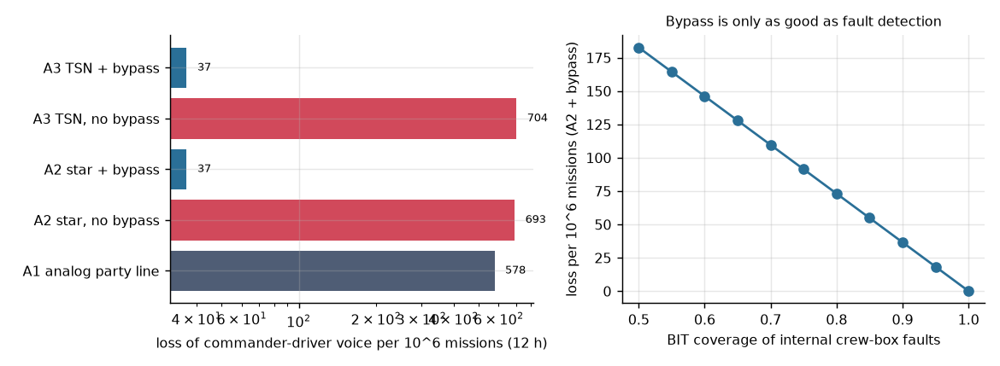

| Architecture | Losses per 10^6 missions | MTBCF |
|---|---|---|
| A1 analog | 578 | 20 800 h |
| A2 without bypass | 693 | 17 300 h |
| **A2 with bypass** | **37** | 80 200 h |
| A3 with bypass | 37 | 80 100 h |

The SYS-3.2.8 objective of 0.9999 (100 per 10^6) is met with the bypass and missed without it. The
coverage curve shows that BIT design, not redundancy, decides the result.

**FMEA** (worksheet columns of W Fig. 34.20, p. 766; severity and probability per MIL-STD-882E as in W
Fig. 34.19, p. 765). Full table: [`results/fmea.md`](results/fmea.md). Two rows set design work:

| Row | Finding | Action |
|---|---|---|
| 8, 9 | **latent failures of the emergency path** (relay stuck energised, emergency amplifier dead) are invisible in operation | **Done in Rev B.** The MAINT self-test (CB-50 … CB-53, decision D7) releases the relay, plays a 1 kHz tone into the emergency line and reads it back on a loopback ADC input. With no loopback the box reports BIT_BYPASS and runs DEGRADED until repaired. Verified on the host and in Renode (IT09 passes a healthy path, IT10 finds a dead one). |
| 10, 11 | CCU faults (stuck radio PTT, a babbling link) | Commander override on radio TX (CCU-04). The point-to-point star keeps a babbling link to one box, whose CRC and concealment then handle it. |
| 7 | ANR divergence is a hearing hazard | guard + output clamp (CB-43, CB-46), verified on the host and in Renode |

## 11. Qualification plan

### 11.1 EMC: MIL-STD-461G, Army ground [R29]

Applicable per Table V: CE102, CS101, CS114, CS115, CS116, RE102, RS103.

| Test | Level (V) | Design concern |
|---|---|---|
| CS114 | curve 3 (10 kHz–2 MHz), curve 4 (2–200 MHz); 95 / 103 dBµA flat | bulk current on the analog emergency line and headset cables: audio-band demodulation is directly audible; transformer isolation and RF filtering at the connector |
| CS101 | 126 dBµV falling to 96.5 dBµV at 150 kHz on 28 V | ripple into the codec supply; LDO PSRR budget |
| CS115 / CS116 | 5 A, 2 ns rise / 10 A damped sinusoid | RS-485 transceiver protection; CRC and concealment make a corrupted frame inaudible (IT04) |
| RS103 | 50 V/m, 2 MHz–18 GHz (40 GHz optional) | own transmitters next to the crew box: the worst case in practice |
| RE102 | 44 → 89 dBµV/m (Army) | RS-485 edge rate; slew-limited transceivers |
| CE102 | 94 dBµV basic curve (28 V) | DC-DC converter input filter |

### 11.2 Environment: MIL-STD-810H [R30]–[R32]

| Method | Parameters | Status |
|---|---|---|
| 501.7 high temperature | A1 hot-dry: 32–49 °C ambient, up to 71 °C induced (Table 501.7-I) | V |
| 502.7 low temperature | C2 cold: −37 to −46 °C (Table 502.7-I) | V |
| 514.8 vibration | ground-vehicle categories; a fielded vehicle intercom uses tracked/wheeled profiles (810G category 20) | vendor practice [R33] |
| 516.8 shock | functional and crash-hazard shock | parameters not verified (A) |
| 507.6 humidity | to be specified | – |
| 509.7 salt fog | to be specified | – |
| 510.7 sand and dust | to be specified | – |
| 512.6 immersion | to be specified | – |

The 509.7, 510.7 and 512.6 parameters are not verified; they come from the procuring specification.

### 11.3 Power: MIL-STD-1275E [R27]

- Steady state: 20–33 V (5.1.1.1).
- Surge: 100 V for 50 ms, 0.5 Ω, 60 J (Table I).
- Spikes: ±250 V for 70 µs, 2 J (Fig. 7).
- IES: 12 V for 1 s. Cranking: 16 V for 30 s (5.1.2).
- Reverse polarity: the equipment protects itself (4.1).

**Input-stage design**, found by analysis S7:

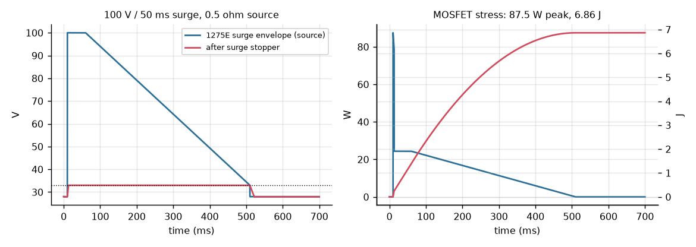

1. **Reverse polarity:** an ideal-diode MOSFET.
2. **TVS for spikes only.** Its stand-off must be above 100 V. A TVS clamping at 36 V would absorb about
   230 J during the 1275E surge (128 A for 50 ms) and fail.
3. **Linear surge stopper** clamping the output at 33 V, with a 1 A current limit. The MOSFET takes
   **6.9 J and an 87 W peak** over the surge. That sets its SOA requirement, and its V_DS rating must
   exceed the TVS clamp voltage.
4. **Wide-input DC-DC, 9–36 V.** It covers IES and cranking with no hold-up. Without it, riding through
   the 1 s IES from 28 V down to 16 V would need **22.7 mF** at 6 W. A 50 ms dropout needs 0.9 mF.

## 12. Software assurance: DO-178C-style plans and evidence

This is the style of DO-178C, not compliance: no certification authority, no independence, no qualified
tools. The plans are condensed into this section.

| Plan or objective | What is done here | Evidence |
|---|---|---|
| Software requirements (SRS) | CB-01 … CB-54 (crew box) and CCU-01 … CCU-08 (CCU core), derived from SYS-3.x | [`fw/SRS.md`](fw/SRS.md) |
| Design standard | pure C99 core library, no heap, no OS calls, caller-owned state; Zephyr glue separate | `fw/lib/icom`, `fw/app` |
| Coding standard | MISRA C:2012 via cppcheck 2.13; one documented deviation (D1: rule 2.5, protocol constants in the public header) | `fw/scripts/misra.sh`, `fw/docs/misra.md` |
| Structural coverage | 100 % statement, branch and **MC/DC** of the core library (GCC 14 `-fcondition-coverage`) | `fw/scripts/test-host.sh`: 663/663 lines, 372/372 branches, 372/372 MC/DC condition outcomes |
| Requirements-based tests | 1370 host checks, including a system test with four boxes and the CCU on real frames; IT01–IT10 in Renode on the real firmware image | `fw/tests` |
| Traceability | every CB and CCU requirement to a test, and every SYS requirement to its evidence; both checked in CI | `fw/tools/trace.py`, `fw/docs/traceability.md`, `tools/trace_sys.py`, `docs/sys_traceability.md` |
| Configuration management | git; CI rebuilds the evidence | `.github/workflows/ci.yml` |
| Not done | independence, tool qualification, object-code coverage, hardware/software integration on the real board, WCET | §14 |

## 13. Verification and validation (W ch. 13, pp. 270–292; ch. 28, pp. 599–622)

### 13.1 Strategy

- **Verification** shows compliance with the specification; **validation** shows the user's need is met
  (W Principles 13.3/13.4, p. 275).
- Use the fewest, cheapest methods that prove compliance (W Principle 13.11, p. 283). Design
  verification must cover robustness to failure (p. 280).

| Requirement | Method | Level | How |
|---|---|---|---|
| SYS-3.2.1 STI | A now; T later | system | S1 model validated by S3; later a head-and-torso simulator in a noise chamber at the recorded vehicle spectrum, STIPA through the real chain |
| SYS-3.2.2 dose | A, T | system | S1; dosimeter in an ear simulator |
| SYS-3.2.4/5 latency | A, T | crew box, system | S4; time-stamped loop-back at the converters |
| SYS-3.2.7 failover | T | crew box (Renode now), system later | IT02, IT03, IT07, IT08; then pull cables and the CCU on the bench |
| SYS-3.2.8 reliability | A | system | S6 parts count, then FRACAS from prototypes |
| SYS-3.4.1 power | A, T | unit | S7; 1275E generator tests |
| SYS-3.5.x EMC/environment | T | unit | accredited laboratory |

### 13.2 Integration (W Figs. 28.2/28.4)

1. **IP1:** crew-box firmware on the host (done) and in Renode with a CCU emulator (done).
2. **IP2:** crew box with headset on the bench, simulated bus.
3. **IP3:** two crew boxes with bus and CCU.
4. **IP4:** full crew complement with emulated radios.
5. **IP5:** in a hull or mock-up, with vehicle power and the data bus.

**Threaded test cases** (W Principle 28.3), for example "commander talks to driver at 85 / 100 / 110 /
115 dB(A)":
- verifies STI, latency and sidetone in one run;
- is then repeated with box 3 failed, a bus cut and the CCU off.

### 13.3 Evidence produced in this repository

**Host.**
- `fw/scripts/test-host.sh`: 1370 checks pass, with 100 % of 663 lines, 372 branches and 372 MC/DC
  condition outcomes (GCC 14).
- `fw/scripts/misra.sh`: no MISRA C:2012 findings apart from deviation D1.
- `fw/tools/trace.py`: 47 of 47 CB and CCU requirements traced, 0 errors.
- `tools/trace_sys.py`: 14 of 14 SYS requirements have evidence and a status
  ([docs/sys_traceability.md](docs/sys_traceability.md)).
- `model/tests`: 16 tests pass.

**Host system test** (`test_system.c`): four crew boxes and the CCU core exchange real encoded frames
every tick.
- Speech reaches another box **1 frame** after the speech frame; the budget of §7.2 allows 3 bus frames.
- The talker never hears itself over the bus (mix-minus).
- A dead box is declared lost by the CCU after 20 ticks, and the others keep talking.
- With the CCU dead, every live box is in BYPASS 20 ms after the last frame it received. They return
  together after 2 s.
- The commander takes over a radio that another box is keying.

**Renode** (`fw/scripts/test-sim.sh`, the test image on the MIMXRT1064-EVK model, with `fw/sim/rig.py`
as the CCU):

| Test | Requirement | Result (virtual time) |
|---|---|---|
| IT01 Boot to NORMAL | CB-20, CB-27 | NORMAL 1.35 ms after boot; relay energised |
| IT02 CCU loss to BYPASS | CB-22, CB-27, CB-04 | BYPASS **20.3 ms** after the last frame; relay dropped at 21.3–22.3 ms (varies by run with the tick phase); telemetry continues |
| IT03 Recovery and no chatter | CB-23 | 0 transitions in 3 s at 50 % frame loss; NORMAL **2000.0 ms** after the link became good |
| IT04 Corrupted frames | CB-12, CB-15 | 1 frame in 10 corrupted for 2 s: 203–204 CRC errors, 203 frames lost (a frame corrupted in the last tick is counted when the next one arrives), no mode change |
| IT05 ANR on target | CB-40, CB-41, CB-05 | 120 dB on the plant's tones; worst `icom_box_tick` 98 838 cycles = **165 µs** |
| IT06 Wrong S_hat caught | CB-28, CB-46, CB-43 | DEGRADED **599 ms** after moving off with a 150° error; largest earphone sample 16 384 = the 0.5 FS clamp; relay stays energised |
| IT07 Critical BIT latches | CB-24 | BYPASS in < 10 ms; still BYPASS 3 s after the fault cleared |
| IT08 Processor stall | CB-27 | relay dropped **1.4–2.1 ms** after the stall (4 runs) |
| IT09 Emergency-path self-test | CB-50, CB-51, CB-52 | in MAINT: relay released during the 300 ms test, re-energised after it; healthy loopback passes (no BIT bits) |
| IT10 Dead emergency path | CB-52 | no loopback: BIT_BYPASS reported; DEGRADED after leaving MAINT |

Notes on the results:
- **IT05.** The 120 dB holds only for the plant's exactly periodic tones with an exact path estimate.
  The realistic figures are the S2 ones (§9.3). The cycle count is Renode's virtual time, not silicon
  timing.
- **IT04** found a real defect: the first version counted each corrupted frame twice (406 lost for 203
  CRC errors). It is fixed in `link.c`, and the fix is recorded in `fw/SRS.md`.

### 13.4 Validation

- Validation needs real crews doing scripted use cases (fire orders, driver commands, radio relay) in a
  running vehicle or a noise chamber, scored by task errors (W Principle 13.14, p. 289).
- Not possible in a portfolio project. It is the main piece an independent test authority would add
  (W Principle 13.15).

## 14. What is sourced, what is assumed, and the limits

**Sourced:**
- noise spectra [R1][R2];
- helmet attenuation [R17];
- ANR insertion gain [R3];
- speech spectra [R14];
- STI constants [R11][R13];
- MRT↔STI table, dose and communication limits [R4][R5];
- delay tolerance [R20]–[R24];
- 1275E, 461G and 810H (temperatures) [R27]–[R32];
- 217F rates [R34];
- converter delays [R37].

**Assumed (A):**
- lip-to-mic distance 1.5 cm;
- speech duty 30 % of the shift and an 8-h exposure;
- the crest factor of 12 dB;
- the 63 Hz helmet value;
- the tonal-share method;
- the track-tone line width and speed jitter;
- the parts lists and π_Q = 1;
- BIT coverage 0.9;
- the mission length of 12 h;
- the harness layout;
- the judged AoA scores;
- the crew-to-crew latency limit, which is a proxy.

**Limits:**
- **Emulated hardware.**
  - The RT1064 runs in Renode. The SAI and audio codec are not modelled, so the test image replaces the
    codec with an acoustic plant model: track tones from the bus speed plus the delayed anti-noise.
  - The bus is a UART at the simulator's speed, not a timed RS-485 line.
  - Cycle counts are Renode's, not the silicon's.
- **The CCU exists as tested core logic only.** Supervision, mix-minus, radio routing and rebroadcast are
  built (`ccu.c`) and tested on the host. Its radio interfaces and hardware are not built, and the Renode rig
  still emulates it on the bus.
- **The hardware-only items are listed in [OPEN_ITEMS.md](OPEN_ITEMS.md)**, each with what would close it.
- **The STI results are model results.** They are validated against the direct method on synthetic
  signals, not against listeners or a measured vehicle.
- **The broadband ANR curve** is one published prototype headset [R3], not a current product.
- **No certification.** This is DO-178C-style evidence only (§12).
- **Vehicle data is from published papers** about other vehicles. The company's own vehicles and
  headsets would change every number in §7.1.

## 15. Decision log

Each decision is recorded with its basis. Wasson treats a trade decision as a resource commitment
(Principle 32.11, pp. 698–700). "Reversible" means it can be changed without changing the requirements.

| ID | Decision | Basis | Alternatives rejected | Reversible |
|---|---|---|---|---|
| D1 | 16 kHz wideband audio (CB-01) | S1: 32 kHz adds 0.006 STI at 111 dB(A), and the 2–8 kHz bands are limited by transmit noise; narrowband costs 0.02–0.05 STI | 8 kHz (narrowband), 32 kHz | yes (frame and bus sizes scale) |
| D2 | 1 ms audio frames (CB-02) | S4: sidetone 5.4 ms against a 10 ms limit; 2 ms frames leave 1.6 ms of margin, and 4 ms frames break the limit | 2, 4 or 8 ms frames | yes |
| D3 | Above 108 dB(A), the system needs about 10 dB more passive attenuation (a communication earplug) or a shorter exposure | S1: no intercom-only configuration meets the 8-h TWA at 111 dB(A); C6 reaches 114 dB(A) | louder earphone (it raises the dose); ANR alone (not enough) | user decision (OPEN_ITEMS H5) |
| D4 | Sidetone through the codec's analog bypass; digital sidetone (5.4 ms) kept as the fallback | MIL-STD-1472G 5.3.1.6 j "in phase"; Stone & Moore limits are met either way | digital only | yes (codec setting) |
| D5 | Architecture A2: star RS-485 TDM, CCU mixing, analog bypass in every box | S5: 7.47 vs 7.38 (A3), wins 68 % of random weightings; no ±10 % weight change flips it | A1 analog party line; A3 TSN with distributed mixing (the growth path) | at the CCU and bus level |
| D6 | Tonal ANR referenced to the sprocket phase; bus speed is the fallback | S2-D: 35 dB with the sprocket phase, 29 dB with 50 Hz bus speed, about 10 dB with unseen wander | reference microphone (causality); speed only | yes (input selection) |
| D7 | Emergency-path self-test through a loopback ADC input, in MAINT only | FMEA rows 8–9 were latent failures; the test needs the relay released, so it is limited to standstill | relying on the crew noticing; a second relay contact as a sense line | yes |
| D8 | Broadband ANR stays analog in the headset; the digital ANR handles tones only | S2-C: the prediction bound falls from 34 dB at 50 µs to 1 dB at 2 ms | digital broadband ANR in the 1 ms pipeline | no (hardware) |
| D9 | 28 V input: TVS standing off 100 V, a linear surge stopper clamping 33 V with a 1 A limit, a 9–36 V converter | S7: a 36 V TVS would absorb 230 J; the stopper takes 6.9 J; IES and cranking need no hold-up | low-voltage TVS; hold-up capacitance (22.7 mF) | no (hardware) |
| D10 | The FxLMS step size is specified per second, not per sample | S3: an unscaled μ at 32 kHz exceeded the delayed-LMS bound and amplified the tones by 3–6 dB | per-sample μ | yes |
| D11 | Downlink commands are one-shot; the maintainer repeats a command that gets no response | Commands are maintenance-only and at standstill. Two frames in one tick keep only the newer one (found by the host test) | acknowledged commands with retries | yes (CCU change only) |

## 16. Open engineering questions, and why they matter to a vehicle-intercom maker

1. **How wide are real track tones, and can a sprocket-phase signal be had from the vehicle?** This
   decides whether speed-referenced tonal ANR gives about 30 dB or about 8 dB (§9.3). It is cheap to
   measure: one recording at the error microphone together with the sprocket pick-up.
2. **Transmit-side SNR at 2–8 kHz.** The model says the microphone, not the ear, limits STI above about
   105 dB(A). Measuring the noise rejection of the company's boom microphone and shield in the 2–8 kHz
   bands would confirm or refute that directly.
3. **Dose at ≥ 110 dB(A).** No intercom-only design meets an 8-h TWA of 85 dB(A) at 111 dB(A) with a
   helmet at the MIL-DTL-44117B attenuation level. The system answer includes the earplug or the
   exposure time, so it belongs in the user's concept of use.
4. **Analog vs digital sidetone** (MIL-STD-1472G "in phase") and the converter path for broadband ANR:
   both point at the codec's analog bypass and low-latency filter options.
5. **BIT coverage of the crew box** is the parameter that decides the fail-operational number (S6). It
   should be designed and measured (fault-injection campaign), not assumed.

## 17. References

**Wasson**

[W] C. S. Wasson, *System Engineering Analysis, Design, and Development: Concepts, Principles, and
Practices*, 2nd ed. Hoboken, NJ: Wiley, 2016. Chapters 4–7, 13, 19–22, 26–28 and 31–34 were read; the
pages are cited in the text.

**Vehicle noise and hearing protection**

[R1] D. G. Zimcik, R. M. Provencher, B. Lecheminant, and D. McNamara, "Measurement of noise in armoured
personnel carriers," NATO RTO-MP-AVT-110, paper 9, 2004.

[R2] K. Buck, P. Hamery, and V. Zimpfer, "The European regulation 2003/10/EC and the impact of its
application to the military noise exposure," in *Proc. ICA 2010*, Sydney, paper 495.

[R3] S. J. van Wijngaarden and S. James, "Protecting crew members against military vehicle noise," NATO
RTO-MP-AVT-110, keynote KN1, 2004.

[R17] MIL-DTL-44117B, *Helmet, Combat Vehicle Crewman, Ballistic Shell*, Table I.

[R18] Vendor datasheet, pressure-gradient dynamic boom microphone, 150 Ω (far-field crossover 2.5 kHz,
−6 dB/octave). The name is withheld under the repository's naming rule and kept in the author's notes.

**Standards**

[R4] MIL-STD-1474E, *Noise Limits*, U.S. DoD, 15 Apr. 2015.

[R5] MIL-STD-1472G w/Change 1, *Human Engineering*, U.S. DoD, 2019. 1472H (2020) exists but was not read.

[R9] ISO 9921:2003, *Ergonomics: Assessment of speech communication*.

[R10] IEC 60268-16:2020 ed. 5, *Objective rating of speech intelligibility by speech transmission
index*. Preview only; constants via [R11]–[R13].

[R24] ITU-T Rec. G.114, *One-way transmission time*, 2003.

[R27] MIL-STD-1275E, *Characteristics of 28 Volt DC Input Power to Utilization Equipment in Military
Vehicles*, 2013.

[R29] MIL-STD-461G, *Requirements for the Control of Electromagnetic Interference Characteristics of
Subsystems and Equipment*, 2015.

[R30] MIL-STD-810H method list (secondary).

[R31] MIL-STD-810H, Method 501.7.

[R32] MIL-STD-810H, Method 502.7.

[R34] MIL-HDBK-217F Notice 2, *Reliability Prediction of Electronic Equipment*, 1995, Appendix A.

**Speech intelligibility and STI**

[R7] NTi Audio, STI know-how page (rating bands).

[R11] Architectural Institute of Japan, STI benchmark problems B-32 / A-21 (IEC 60268-16:2020 constants).

[R12] MathWorks, "Speech transmission index IEC 60268-16 edition 5 compliance."

[R13] P. Rajmic, J. Schimmel, and Š. Cieslar, "A MATLAB toolbox for computation of speech transmission
index," arXiv:2510.03825, 2025.

[R14] ANSI S3.5-1997 speech spectra, via the R package "SII" documentation.

[R15] P. Bottalico et al., "Evaluation of the starting point of the Lombard effect," *Acta Acust. united
Acust.*, 103(1), 2017.

[R38] P. C. Loizou and G. Kim, "Reasons why current speech-enhancement algorithms do not improve speech
intelligibility," *IEEE Trans. Audio, Speech, Lang. Process.*, 19(1), 2011. This is why single-channel
noise suppression is not counted on for STI here (from memory, not re-read in this session).

**Delay tolerance**

[R20] M. A. Stone and B. C. J. Moore, "Tolerable hearing aid delays. I," *Ear Hear.*, 20(3), 1999.

[R21] M. A. Stone and B. C. J. Moore, "Tolerable hearing aid delays. II," *Ear Hear.*, 23(4), 2002.

[R22] M. A. Stone and B. C. J. Moore, "Tolerable hearing aid delays. III," *Ear Hear.*, 24(2), 2003.

[R23] M. A. Stone and B. C. J. Moore, "Tolerable hearing aid delays. IV," *Ear Hear.*, 26(2), 2005.

**Equipment, networks and ANR theory**

[R33] Vendor datasheet of a fielded digital vehicle intercom (environmental qualification table). The
name is withheld; kept in the author's notes.

[R36] Audio Video Bridging stream-reservation class A bound of 2 ms over 7 hops (secondary;
IEEE 802.1BA not read).

[R37] Texas Instruments, *TLV320AIC3204 Application Reference Guide*, SLAA557, 2012, Tables 2-11 to
2-13 and 2-19 to 2-21 (converter filter group delays).

[R39] S. M. Kuo and D. R. Morgan, *Active Noise Control Systems: Algorithms and DSP Implementations*,
Wiley, 1996. Filtered-x LMS and its ±90° phase condition (background, not re-read).

**Where the evidence is.** The verification status of every number, the URLs, and the record of what
could not be fetched (DTIC was offline) are in [`docs/sources.md`](docs/sources.md).

---

**Revision history**

| Rev | Date | Change |
|---|---|---|
| A | 9 Nov 2026 | First issue |
| B | 10 Nov 2026 | CCU core built and tested; emergency-path self-test (closes FMEA rows 8–9); host system test with four boxes and the CCU; system-level verification matrix (`docs/sys_traceability.md`) checked in CI; decision log; OPEN_ITEMS.md; Renode IT09–IT10 |
