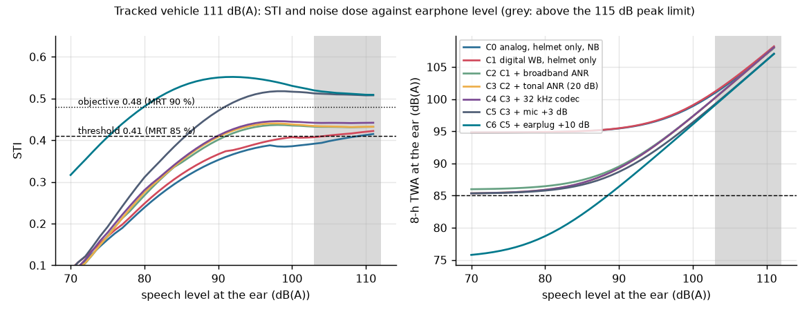

# Digital crew intercom for an armoured vehicle

This repository studies one engineering question.

**The question:** can crew speech stay intelligible in 110 dB(A) and more of vehicle noise, within a
latency and sidetone budget and within the hearing-exposure limit? And how does the intercom stay
working when a crew box, the bus or the central unit fails?

**What it contains:**
- **[DOSSIER.md](DOSSIER.md)** ([PDF](DOSSIER.pdf)): the engineering dossier. It follows Wasson's
  systems-engineering spine:
  - mission and use cases;
  - modes and states;
  - requirements traced to MIL-STD-1474E/1472G, IEC 60268-16 and MIL-STD-1275E/461G/810H;
  - architecture and interfaces;
  - budgets and margins;
  - analysis of alternatives;
  - modelling and simulation;
  - RMA/FMEA;
  - verification and validation.
- **`model/`**: the Python models that answer the question:
  - speech chain and STI per IEC 60268-16, with both the indirect method and STIPA;
  - adaptive ANR;
  - latency budgets;
  - trade study;
  - reliability;
  - 28 V input stage.
- **`fw/`**: crew-box firmware in C for an NXP i.MX RT1064 on Zephyr:
  - bus framing, link supervision, operating states with a fail-safe analog bypass, priority mixer and a
    speed-referenced FxLMS ANR;
  - tested on the host with 100 % MC/DC coverage;
  - tested in the Renode emulator against a CCU emulator.

It is a portfolio and thesis-preparation project, not a product, and not certified.



## Findings

| Question | Answer | Evidence |
|---|---|---|
| Where is intelligibility lost at 111 dB(A)? | On the **transmit side**. The boom microphone's SNR is −4 to −8 dB at 2–8 kHz, which caps the STI at 0.44 whatever the earphone, ANR or codec. | S1, DOSSIER §9.2 |
| Can it meet the MIL-STD-1474E threshold (STI 0.41, MRT 85 %)? | Yes, with broadband ANR, at 91 dB(A) at the ear. The objective of 0.48 needs +3 dB transmit SNR (microphone, not DSP). | S1 |
| Hearing dose? | The binding constraint. The 8-h TWA is 89.9 dB(A) against the 85 limit. Good to 108–109 dB(A) tracked and 105 dB(A) wheeled; up to 114 dB(A) with a communication earplug (+10 dB). | S1 |
| Which ANR goes where? | Broadband feedback ANR loses its predictability bound in the frame pipeline: 34 dB at 50 µs, 12 dB at 0.5 ms, 1 dB at 2 ms. Tonal ANR referenced to the track frequency tolerates the delay: 35 dB with a sprocket-phase reference, 29 dB with bus speed at 50 Hz. | S2 |
| Does the tonal ANR improve STI? | Measured through the adaptive filter with STIPA: +0.002. Its value is noise dose, not intelligibility, and it does not cancel speech. | S3 |
| Is the STI model right? | It matches the direct STIPA method within 0.012 at STI ≥ 0.4 (worst case 0.037 at STI 0.1). | S3 |
| Latency? | Sidetone 5.4 ms (limit 10 ms); crew-to-crew 8.6 ms (limit 20 ms). A 1 ms frame is required, and 4 ms frames break the sidetone limit. | S4 |
| Architecture? | Digital star with CCU mixing and an analog bypass (7.47) over TSN with distributed mixing (7.38). It wins 68 % of 20 000 random weightings. | S5 |
| Fail-operational? | The bypass cuts loss of commander–driver voice from 693 to 37 per 10^6 12-h missions. BIT coverage decides the number. | S6 |
| 28 V transients? | The TVS must stand off the 100 V surge (a 36 V clamp would take 230 J). A linear stopper takes 6.9 J; a 9–36 V converter rides through IES and cranking. | S7 |

## Firmware evidence

| Check | Result |
|---|---|
| Host unit tests (`fw/scripts/test-host.sh`) | 1284 checks; **100 % lines (500), branches (274), MC/DC condition outcomes (274)**, GCC 14 |
| MISRA C:2012 (`fw/scripts/misra.sh`, cppcheck addon) | no findings outside deviation D1 ([fw/docs/misra.md](fw/docs/misra.md)) |
| Traceability (`fw/tools/trace.py`) | 34/34 requirements of [fw/SRS.md](fw/SRS.md) traced to existing tests |
| Renode IT01–IT08 (`fw/scripts/test-sim.sh`) | 8/8 pass |
| IT02 CCU loss to bypass | BYPASS 20.3 ms after the last frame |
| IT03 recovery | NORMAL 2000 ms after the link is good; 0 transitions at 50 % frame loss |
| IT06 wrong ANR calibration | guard trips after 599 ms; output held at the clamp |
| IT08 processor stall | relay drops after 1.4–2.1 ms |
| Defect found by the tests | IT04: lost frames were counted twice. Fixed; see [fw/SRS.md](fw/SRS.md) revision history |

## Layout

| Path | What it is |
|---|---|
| `DOSSIER.md` | the engineering dossier (Wasson chapter and page citations, reference list) |
| `docs/sources.md` | source register: every number with its source, location and verification status |
| `docs/img/` | figures produced by the studies |
| `model/icsim/` | `sti.py` (IEC 60268-16 indirect + STIPA direct), `chain.py` (speech chain, dose), `anr.py` (FxLMS, prediction bound), `budget.py`, `rma.py`, `data.py` (sourced inputs) |
| `model/studies/` | S1 chain, S2 ANR, S3 STI validation, S4 latency, S5 AoA, S6 RMA, S7 power |
| `results/` | JSON results and the FMEA table |
| `fw/lib/icom/` | crew-box core library, pure C99: `frame.c`, `link.c`, `modes.c`, `mix.c`, `anr.c`, `box.c` |
| `fw/app/` | Zephyr application for `mimxrt1064_evk` (test image: acoustic plant and fault hooks) |
| `fw/sim/` | Renode platform, and `rig.py` (CCU emulator, relay model) |
| `fw/tests/` | host unit tests and Robot Framework tests IT01–IT08 |

## Quick start

**Models** (Python 3.12):

```bash
pip install -r requirements.txt
python -m pytest -q model/tests
python model/run_all.py          # all studies; S3 takes about 5 minutes
python tools/make_pdf.py         # DOSSIER.md -> DOSSIER.pdf (needs markdown, pymupdf)
```

**Firmware library** (Linux or WSL2, with gcc-14 and cppcheck):

```bash
bash fw/scripts/test-host.sh
bash fw/scripts/misra.sh
python3 fw/tools/trace.py
```

**Firmware and Renode tests:** set up a west workspace the way `.github/workflows/ci.yml` does, then:

```bash
export ICOM_WS=/path/to/west-workspace ICOM_VENV=/path/to/venv
bash fw/scripts/build.sh
bash fw/scripts/test-sim.sh
```

## Limits

All limits are detailed in DOSSIER §14.

- **The STI and dose figures are model results.** The model is validated against the direct STIPA method
  on synthetic signals, not with listeners or in a vehicle.
- **The vehicle spectra and helmet data come from published papers.** They are not measurements on any
  particular in-service vehicle.
- **The audio codec and SAI are not modelled in Renode.** The test image replaces them with an acoustic
  plant model.
- **The bus is a UART at simulator speed.**
- **Cycle counts are Renode's virtual time.**
- **The CCU is not built.**
- **Not certified.** The software process is DO-178C *style* only.

## Licence

MIT. See [LICENSE](LICENSE).
